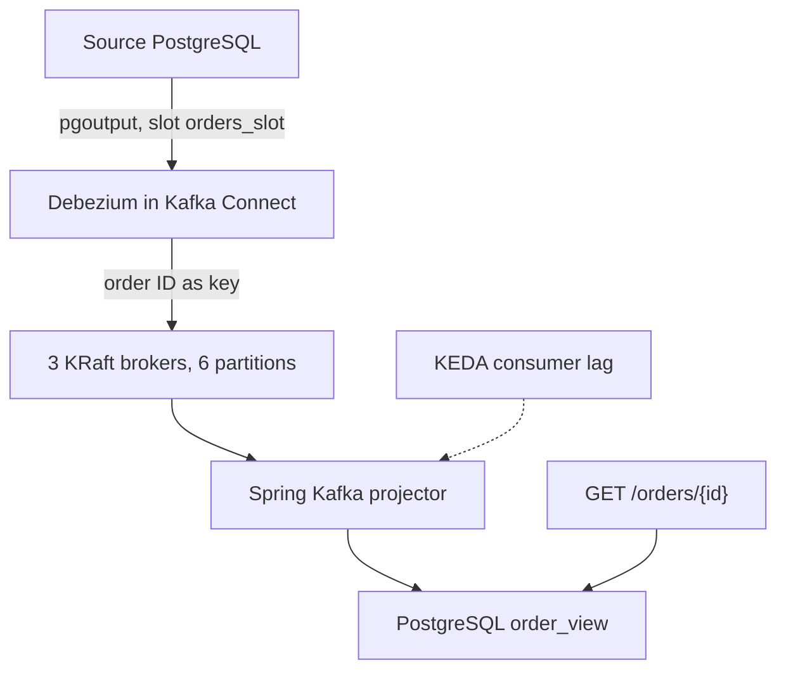

# PostgreSQL change data capture with Spring and Kafka

Change an order in PostgreSQL and watch a separate read database catch up. The only publisher is Debezium. Any committed SQL change to `public.orders` enters the same pipeline, including a change made directly in psql.



## First run

Use Docker Desktop with Linux containers and Compose v2, WSL2/Bash, OpenSSL, curl and Python 3. Start one lab at a time. Allow extra time for the first Docker/Maven downloads. The multi-stage image builds and tests Java 17 with Maven. You can also run `mvn verify` with a local JDK 17.

```bash
git clone https://github.com/milindyadav777/spring-postgres-cdc.git
cd spring-postgres-cdc
./scripts/init-env.sh
docker compose up -d --build
python3 scripts/smoke.py
```

The smoke test waits for the initial snapshot, inserts a fresh order, stops the consumer, updates the source, restarts the consumer and checks that the sink catches up. It checks a physical delete and the retained deletion marker. It uses synthetic rows. To inspect one order interactively:

```bash
docker compose exec source psql -U postgres -d orders
INSERT INTO orders(status) VALUES ('CREATED') RETURNING id;
-- Use the returned id below, for example 2.
UPDATE orders SET status='PAID' WHERE id=2;
\q
curl -i http://localhost:8080/orders/2
curl -s http://localhost:8083/connectors/orders-cdc/status
docker compose exec kafka-0 /opt/kafka/bin/kafka-consumer-groups.sh \
  --bootstrap-server kafka-0:9092 --group order-projector-v1 --describe
```

A fresh database starts with order 1. Before asserting success, wait for the connector and its task to report RUNNING. To see the actual snapshot, update, delete and null tombstone records:

```bash
docker compose exec kafka-0 /opt/kafka/bin/kafka-console-consumer.sh \
  --bootstrap-server kafka-0:9092 --topic orders.public.orders --from-beginning \
  --property print.key=true --property print.partition=true --property print.offset=true
```

## Trace the code

1. `infra/source.sh` creates the logical publication, replication user, stable order ID and a database-assigned revision. `REPLICA IDENTITY FULL` includes the last revision in the delete's before-image. Rolled-back changes produce no committed row event.
2. `infra/connector.json` limits capture to one table and uses schemaless JSON. The initial snapshot gives the starting rows. Streaming continues from WAL. Kafka Connect persists its offsets and status in replicated Kafka topics.
3. `OrderChange.java` maps snapshot/read, insert, update and delete envelopes. `Projector.java` commits one sink upsert before Spring acknowledges the Kafka record. On redelivery the same version has no effect. A delete wins over a live row at the same revision. Keeping the deletion marker prevents an older record from resurrecting the order.
4. `RetryConfig.java` keeps a failed record on retry. An incompatible event can stall the assigned consumer. Inspect lag and errors, deploy a parser fix, then resume. The implementation never silently drops an envelope.
5. `OrderQuery.java` exposes the projected state. A 404 immediately after a source insert is possible. KEDA scales this combined consumer/query process from one to six pods, using the consumer group lag and the six available partitions. The read API retains one pod.

## Practice in 60–90 minutes

| Time | Exercise | What to observe |
| --- | --- | --- |
| 15 min | Start Compose and inspect the connector and topic | Three brokers, replication factor 3, minimum ISR 2 |
| 20 min | Insert, update, roll back and physically delete an order | Committed transitions appear; the delete envelope precedes a null tombstone |
| 20 min | Stop the projector, write two changes, inspect lag, restart | The source continues accepting writes and the read model converges |
| 15 min | Walk through a crash after SQL commit and before offset commit | The repeated upsert loses its version comparison |
| Optional | Rewind the stopped lab consumer group to earliest | Old records leave the newer read model intact |

```bash
docker compose stop projector
docker compose exec kafka-0 /opt/kafka/bin/kafka-consumer-groups.sh \
  --bootstrap-server kafka-0:9092 --group order-projector-v1 --topic orders.public.orders \
  --reset-offsets --to-earliest --execute
docker compose start projector
```

Use `docker compose stop` to pause the lab with data intact and `docker compose start` to resume. The source read role is separate from the sink application role. The HTTP API and Connect administration interface bind to loopback in Compose. Keep the generated `.env` with its volumes.

## Kubernetes

With Docker, kind, kubectl, Helm 3, Bash and OpenSSL available, run from the repository root:

```bash
./scripts/kind-up.sh
```

The script uses the named kind context `kind-spring-labs`, installs KEDA if its CRD is absent, provisions the lab data services and starts the application. A default StorageClass with dynamic PVC provisioning is required. It prints the port-forward command. `infra/k8s/` contains the native Kubernetes manifests; `infra/kustomization.yaml` packages their startup scripts. `helm/cdc/` owns the Spring deployments, Service, and KEDA configuration. To inspect both sets of objects:

```bash
kubectl kustomize infra
helm template cdc helm/cdc --namespace cdc-lab
kubectl --context kind-spring-labs -n cdc-lab get pods,pvc,jobs,scaledobjects,hpa
```

For an existing cluster, build and publish the application image to a registry available to its nodes. Supply your own endpoint values, provision the database tables/roles from `infra/`, create the Secret named by `existingSecret`, then install with `helm upgrade --install cdc helm/cdc -n YOUR_NAMESPACE -f your-values.yaml --set image=YOUR_IMAGE`. Use a separate namespace for each lab. The data-plane manifests use PVCs and cluster-internal DNS. Their small topologies and plaintext in-cluster transport are for isolated practice.

## Deployment boundaries

This sample owns a single Maven module and one application image. The source revision and delete-fence contract belong to the source schema. Schema changes need compatibility tests. Restrict source writers to row-level DML and keep ID/revision sequences monotonic. TRUNCATE, resetting sequences, and restoring the source independently of the projection require a coordinated rebuild. Removing old deletion fences while replay is possible can corrupt the read model.

The data topic has seven days of retention. The source slot is capped at 1 GiB of retained WAL. Alert on consumer lag, stalled tasks, retained WAL, and disk utilization. If the slot is invalidated or input history expires, rebuild into a fresh sink from a consistent snapshot and cut over after catch-up. A single Kafka Connect worker and the two single PostgreSQL pods are local availability limits. A production rollout needs tested failover, backups and restore, workload-specific capacity, authenticated HTTP access, Kafka ACLs/TLS, database TLS, secret rotation and a load-tested rollout. The projector exposes `/actuator/prometheus` and dependency-aware readiness for the sink.

References: [Debezium PostgreSQL connector](https://debezium.io/documentation/reference/3.3/connectors/postgresql.html) · [KEDA Kafka scaler](https://keda.sh/docs/2.18/scalers/apache-kafka/)
